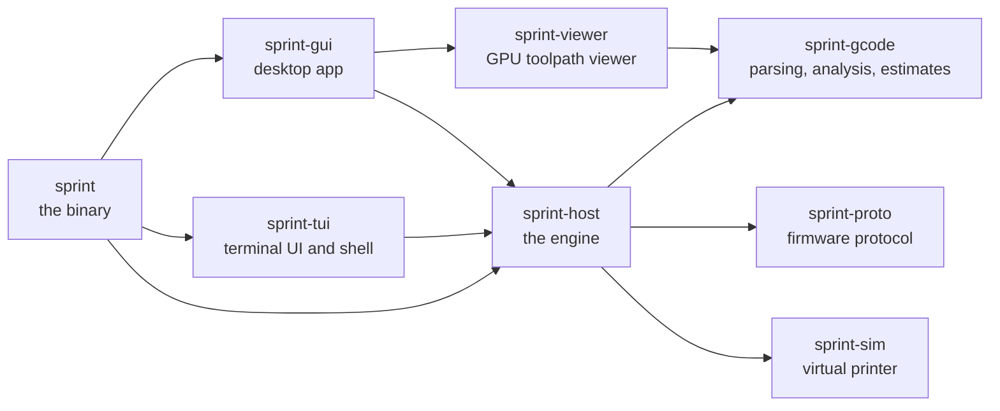

<div align="center">


# Sprint

**A fast, modern 3D-printer host, written in Rust.**

Desktop GUI · terminal UI · interactive shell · scriptable CLI · built-in virtual printer

[](https://github.com/PeterDessev/Sprint/actions/workflows/ci.yml)
[](#license)
[](https://www.rust-lang.org/tools/install)

[Features](#features) · [Quick start](#quick-start) · [Screenshots](#screenshots) · [Documentation](#documentation) · [Contributing](#contributing)

</div>

<br>

<picture>
  <source media="(prefers-color-scheme: light)" srcset="docs/images/gui-light.png">
  
</picture>

<br>

Sprint loads big G-code files in a moment, shows them on the GPU, estimates
print time with a planner that models motion the way the firmware does, and
streams to your printer over USB serial or TCP with resends, recovery and an
emergency stop that is always in reach. It is one self-contained program,
and its built-in virtual printer lets you try every feature without
hardware.

> [!NOTE]
> **Tested on a real printer.** Sprint has driven a Marlin bugfix-2.1.x
> delta over a CP210x USB serial link at 250000 baud: baud-rate
> auto-detection, homing, jogging, an `M109` heat wait, a board reset over
> DTR with reconnect, and a print in the air with pause, resume and cancel,
> with **zero** resends, errors or timeouts. It streamed **about 775 lines/s**
> one command at a time and **about 1700 lines/s** with four in flight.

## Features

<table>
<tr>
<td width="50%" valign="top">

### Four front ends, one engine

A desktop GUI, a terminal UI that runs over SSH, an interactive shell and
headless commands for scripts, all on the same host engine, the same
safety rules and one configuration file.

</td>
<td width="50%" valign="top">

### G-code on the GPU

Millions of segments as lit 3D beads or lines, a layer view, colour by
feature, speed, width, layer height, tool, fan, layer or time, and
scrubbing through a layer move by move, linked to the G-code text.

</td>
</tr>
<tr>
<td valign="top">

### Close print-time estimates

A kinematic planner with acceleration, junction deviation or jerk and
look-ahead, using the firmware's limits, plus filament use, part size and
per-feature statistics. Reads slicer metadata and thumbnails from
PrusaSlicer, OrcaSlicer, Cura and more.

</td>
<td valign="top">

### Streams reliably

Line numbers and checksums, resends, recovery from lost replies,
baud-rate auto-detection and several commands in flight when the firmware
keeps up, over USB serial or a TCP bridge.

</td>
</tr>
<tr>
<td valign="top">

### Prints that recover

Start from any line or layer with a generated resume preamble, pick up a
failed print at the first line the printer did not confirm, pause at a
layer and skip objects mid-print (`M486`, Klipper `EXCLUDE_OBJECT`, slicer
labels).

</td>
<td valign="top">

### Knows your printer

Firmware capabilities, every `M503` setting with descriptions and an
EEPROM editor, PID, E-steps, Z-offset and flow wizards, live tuning, and the
bed mesh as a heatmap and 3D surface with a bed-screw helper.

</td>
</tr>
<tr>
<td valign="top">

### A virtual printer built in

A simulated Marlin 2.1 board with heaters, a planner, an SD card, a bed
mesh, host prompts and fault injection. Try everything without hardware, or
serve it over TCP to other programs.

</td>
<td valign="top">

### Safe by default

An always-visible E-STOP, one set of confirmation rules in every front end,
no connection you did not ask for, heaters off when a print fails, and
files that are not G-code are never streamed.

</td>
</tr>
</table>

### One program, every interface

Everything is a subcommand of the one `sprint` program:

| Subcommand | What it does |
|---|---|
| `gui` | Opens the desktop GUI, optionally with a file; `sprint` alone does the same |
| `tui` | Opens the full-screen terminal UI, with a Braille layer view; works over SSH |
| `shell` | Opens the interactive shell, with history, completion and macros; runs scripts from a file, a pipe or `-e` |
| `print` | Prints a file headless, with progress and exit codes; a failed print reports the `--start-line` that resumes it |
| `send` | Sends commands and prints the replies; the exit status says whether every one was acknowledged |
| `analyze` | Reports a file's statistics and print-time estimate, or prints them as JSON |
| `ports` | Lists serial ports without opening them |
| `sim` | Serves the virtual printer over TCP |

<details>
<summary><b>How Sprint keeps the printer safe</b></summary>

<br>

* **Emergency stop.** The red **E-STOP** in the GUI (visible even above
  dialogs), F8 twice in the terminal UI, or `M112` typed anywhere sends
  `M112` at once, ahead of everything queued. Sprint then offers to reset
  the board.
* **Confirmations.** Every front end uses the same rules: dangerous
  commands ask before they are sent, and commands that would ruin a running
  print (homing, moves, mode changes, ...) ask or are refused while it
  prints.
* **No surprise connections.** Ports open only when you connect. Opening a
  serial port resets many boards, which would stop a print running from the
  printer's own SD card.
* **Failures turn the heat off.** When a host print fails while the printer
  still answers, Sprint turns the heaters and the part fan off
  (configurable per profile).
* **Only G-code is printed.** STL, 3MF, OBJ and STEP models and binary
  files are recognised and refused with an explanation.

</details>

## Quick start

Sprint builds from source with the stable Rust toolchain, 1.95 or newer
([install Rust](https://www.rust-lang.org/tools/install)). There are no
pre-built binaries yet.

```bash
git clone https://github.com/PeterDessev/Sprint
cd Sprint
cargo build --release
```

The result is one program, `target/release/sprint` (`sprint.exe` on
Windows), with every front end inside. Put it on your `PATH`, or run the
commands below as `cargo run --release -- <args>`.

> [!TIP]
> On Linux, install the libudev development files before building
> (`libudev-dev` on Debian and Ubuntu, `systemd-devel` on Fedora), and join
> the `dialout` group (`uucp` on some distributions) to open serial ports.

### Try it without a printer

```bash
sprint --sim samples/calibration-cube.gcode   # the GUI, connected, with a file
sprint tui -c sim                              # the terminal UI
sprint shell -c sim                            # the shell; type help
sprint analyze samples/calibration-cube.gcode  # statistics and estimate
```

The virtual printer runs in real time, so a print takes as long as it
would on a printer. Its options speed it up:

```bash
sprint print samples/calibration-cube.gcode -c "sim://?time_scale=50&instant_moves=true"
```

> [!WARNING]
> The files in [`samples/`](samples/README.md) were generated for Cartesian
> printers with the origin at the front left. Check them before sending one
> to a real printer: on a delta or a smaller bed they are not safe as they
> are.

### Connect a printer

```bash
sprint ports                          # list the serial ports
sprint shell -c COM3@auto             # try the common baud rates
sprint tui -c /dev/ttyUSB0@250000
sprint send -c COM3 M115              # one command, print the reply
sprint print part.gcode -c COM3@250000
```

In the GUI, pick the port and baud rate in the connection bar and press
**Connect**. **Tools > Printer profiles** keeps the port, bed size, scripts
and options of each printer.

<details>
<summary><b>Connection targets</b></summary>

<br>

| Target | Meaning |
|---|---|
| `COM3`, `/dev/ttyUSB0` | Serial port at 115200 baud |
| `COM3@250000` | Serial port at that baud rate |
| `COM3@auto` | Try the common baud rates until the printer answers |
| `tcp://192.168.1.50:23` | A serial-to-network bridge (ESP3D, ser2net, ...) |
| `sim`, `sim://?time_scale=50` | The built-in virtual printer, with options |

</details>

## Screenshots

<table>
<tr>
<td width="50%" valign="top">

<p align="center"><sub>Start from a layer or line, with a resume preamble you can check and edit</sub></p>
</td>
<td width="50%" valign="top">

<p align="center"><sub>The terminal UI, following a print</sub></p>
</td>
</tr>
<tr>
<td valign="top">

<p align="center"><sub>Every firmware setting, edited and saved to EEPROM</sub></p>
</td>
<td valign="top">

<p align="center"><sub>Step-by-step calibration wizards</sub></p>
</td>
</tr>
<tr>
<td valign="top">

<p align="center"><sub>Firmware, thermal health, link quality, capabilities and settings</sub></p>
</td>
<td valign="top">

<p align="center"><sub>Bed mesh heatmap, 3D surface and how far to turn each screw</sub></p>
</td>
</tr>
</table>


## Status

Sprint [0.1.0](CHANGELOG.md) is the first release (2026-10-19). It is
developed and hardware-tested on Windows with Marlin, and CI builds and
tests it on Linux and macOS as well. Only Marlin has been tried on a real
printer so far, so reports from other firmware are welcome.

**Not there yet:** slicing (slice in your slicer and open the G-code),
spool tracking, translations, a network API for remote monitoring (hook
commands can report job events to other programs), a communication log
written to a file as it happens, and plugins beyond G-code macros.

## Documentation

| Page | What's in it |
|---|---|
| [User guide](docs/user-guide.md) | Installing, first steps, connection targets, printer profiles and safety |
| [GUI](docs/gui.md) · [Terminal UI](docs/tui.md) · [Shell](docs/shell.md) · [Command line](docs/cli.md) | One page per front end |
| [Configuration](docs/configuration.md) | The TOML file, printer profiles, scripts and placeholders, hook commands |
| [Virtual printer](docs/virtual-printer.md) | Its options, fault injection and serving it over TCP |
| [Troubleshooting](docs/troubleshooting.md) | Connections, resends, timeouts, halts and board resets |
| [Architecture](ARCHITECTURE.md) | The crates and the contract between them |
| [Changelog](CHANGELOG.md) | What changed in each release |

## Contributing

Bug reports and pull requests are welcome: [CONTRIBUTING.md](CONTRIBUTING.md)
explains how to build, test and send changes. Tests use the virtual printer
and never open a serial port.

```bash
cargo test --workspace
```

The workspace has one crate per layer:



## Credits

Inspired by [Printrun](https://github.com/kliment/Printrun) (Pronterface /
pronsole) by Kliment and contributors. Built with Rust,
[egui](https://github.com/emilk/egui), eframe,
[wgpu](https://github.com/gfx-rs/wgpu), [ratatui](https://github.com/ratatui/ratatui)
and [Phosphor icons](https://phosphoricons.com).

## License

Sprint is dual-licensed under the [MIT license](LICENSE-MIT) or the
[Apache License, Version 2.0](LICENSE-APACHE), at your option.

Unless you explicitly state otherwise, any contribution intentionally
submitted for inclusion in Sprint by you, as defined in the Apache-2.0
license, shall be dual licensed as above, without any additional terms or
conditions.
