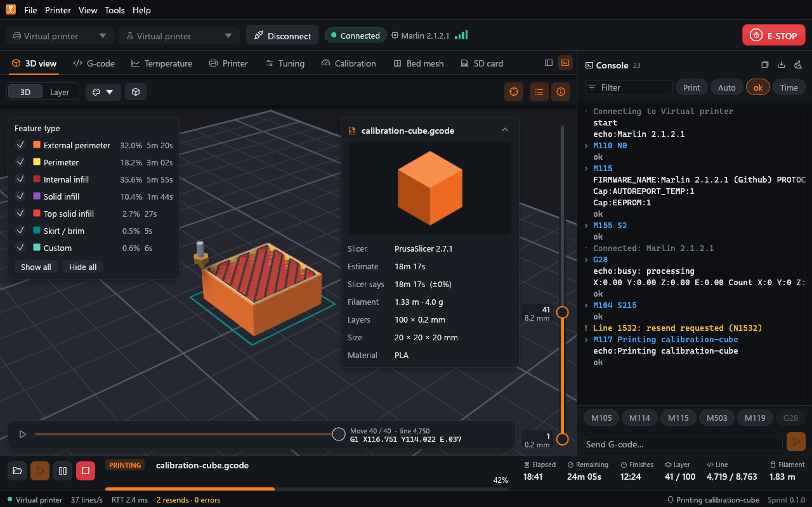
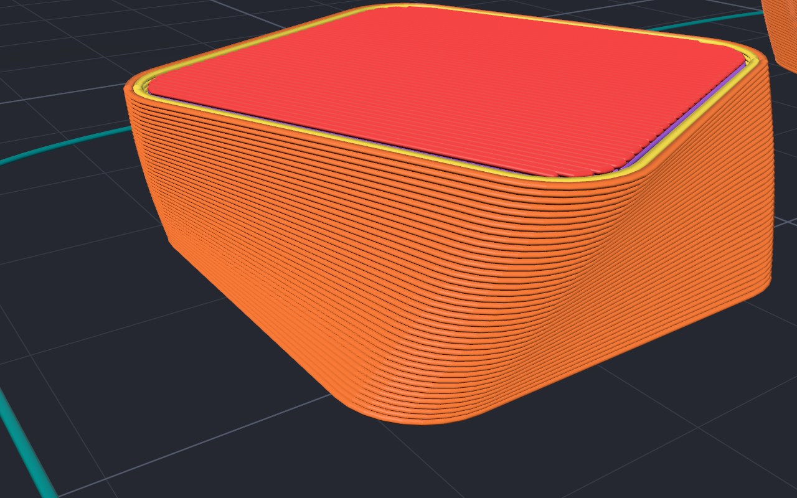
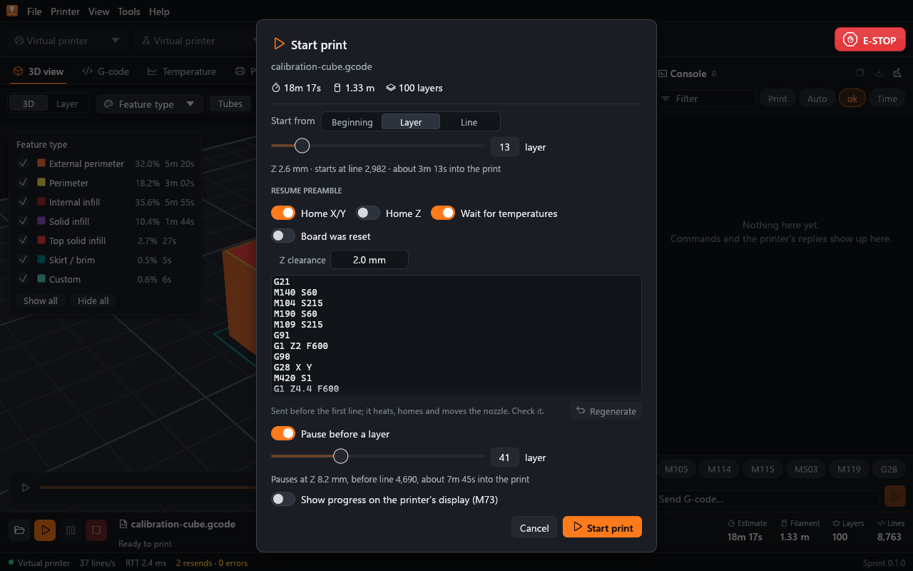
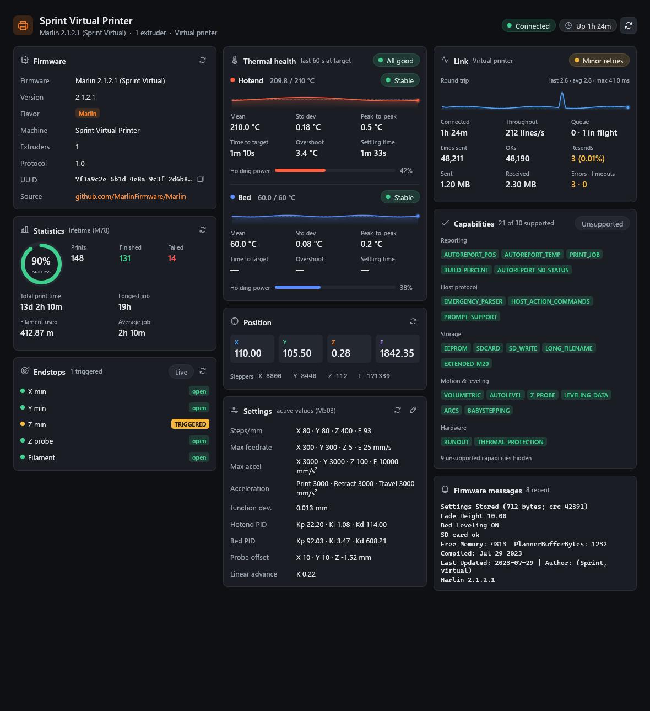
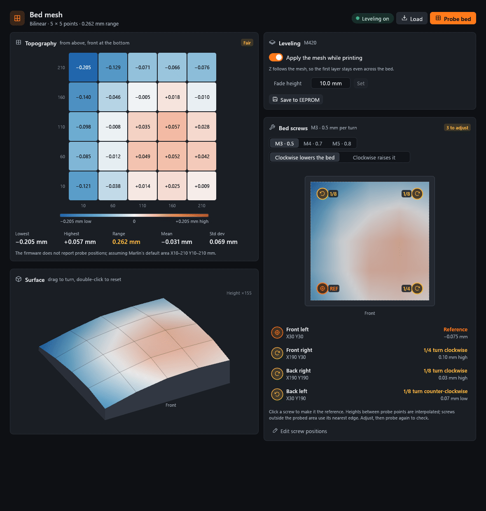
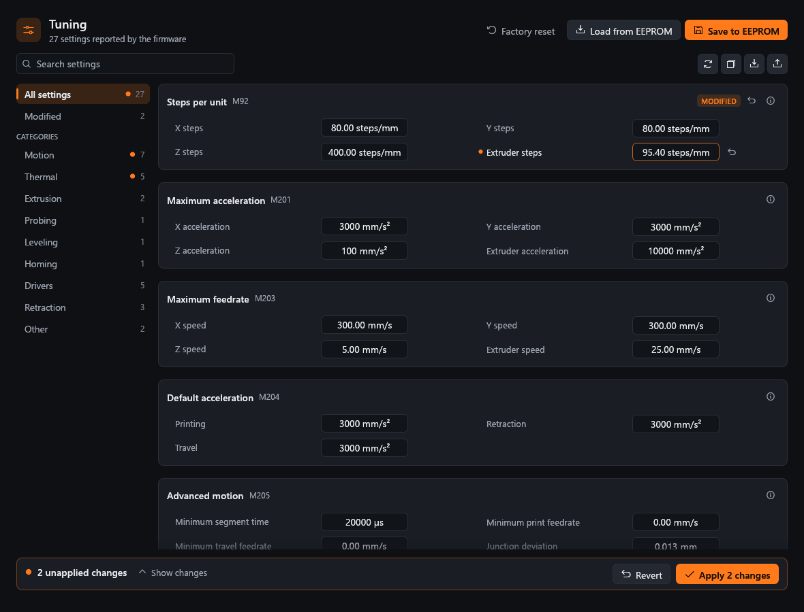
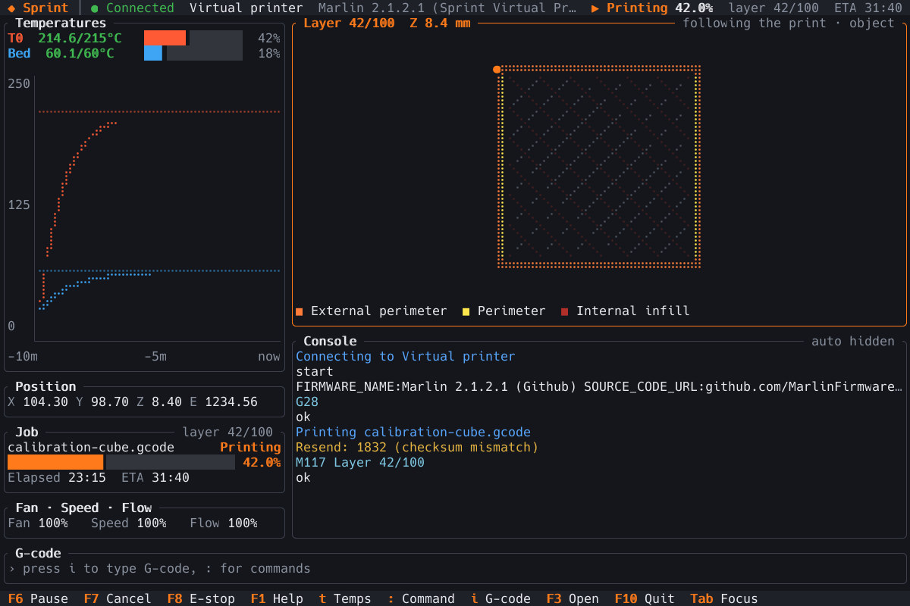

# Sprint

**A fast, modern 3D-printer host written in Rust.** One self-contained
program that replaces [Printrun](https://github.com/kliment/Printrun)
(Pronterface and pronsole) with a GPU-rendered desktop GUI, a terminal UI
that runs over SSH, a pronsole-style shell, scriptable command-line tools
and a built-in virtual printer.

[](https://github.com/PeterDessev/Sprint/actions/workflows/ci.yml)
[](#license)
[](https://www.rust-lang.org/tools/install)



Load a big G-code file in a moment and fly around it in 3D, get a print-time
estimate from a planner that thinks like your firmware, then stream it over
USB serial or TCP with resends, recovery and an emergency stop that is
always in reach. No printer at hand? Sprint has a virtual Marlin
board built in, so every feature works without hardware.

**Tested on a real printer.** Sprint has run on a Marlin bugfix-2.1.x
delta over a CP210x USB serial link at 250000 baud: baud-rate
auto-detection, firmware, temperature, position, settings and endstop
reports, homing with `busy:` keepalives, jogging, an `M109` heat wait, a
board reset over DTR with reconnect, and a print (in the air) with pause,
resume and cancel, all with zero resends, errors or timeouts. On that board
it streamed about 775 lines/s with one command in flight and about
1700 lines/s with four.

## What's inside

### A desktop GUI

The full workbench: a connection bar with printer profiles and an
always-visible **E-STOP**, temperature, jog, extrusion and live-tuning
controls (speed, flow, fan, babystepping), macros, and a console with
filters, history and G-code completion. Tabs show the 3D and layer view,
the G-code text with a reference on hover, the temperature graph, everything
the firmware reports about itself, a settings and EEPROM editor for every
`M503` setting, calibration wizards (PID autotune, extruder E-steps,
Z offset, flow), the bed mesh as a heatmap and 3D surface with a bed-screw
helper, and the SD card. Dark and light themes, drag and drop, keyboard
shortcuts.

### A terminal UI

`sprint tui` puts temperatures, position, job progress, a Braille layer
view that follows the print, the console, jogging and a command palette in
a full-screen terminal interface: handy over SSH to the computer next to
the printer.

### A pronsole-style shell

`sprint shell` accepts most pronsole commands as they are, with history,
completion, a G-code reference in `help`, macros with arguments
(`{0}`, `{1=200}`, `{args}`) and printer profiles. Commands can come from
a file, a pipe or `-e`, so the shell runs scripts too.

### Command-line tools for scripts

* `sprint print` prints a file headless, with progress, exit codes and
  recovery: a failed print reports the line to resume from with
  `--start-line`.
* `sprint send` sends commands and prints the replies; its exit status
  tells a script whether every command was acknowledged.
* `sprint analyze` reports a file's statistics, or prints them as JSON.
* `sprint ports` lists serial ports without opening them.
* `sprint sim` serves the virtual printer over TCP for other hosts.

### A built-in virtual printer

A simulated Marlin 2.1 board with a thermal model, planner timing, an SD
card, a bed mesh, PID autotune, host prompts and fault injection (corrupted
lines, lost replies). Connect to `sim` from any front end and everything
works as it would on a printer, faster than real time if you like.

### G-code analysis and preview

* A GPU toolpath viewer that handles millions of segments: lit 3D beads or
  lines, a layer view, colour by feature, speed, width, layer height, tool,
  fan, layer or time, layer ranges, scrubbing through a layer's moves and
  picking a move to find it in the G-code text. During a print the printed
  part is solid, the rest ghosted, and the tool head follows along.
* Print-time estimates from a kinematic planner with acceleration,
  junction deviation or jerk and look-ahead, using the firmware's limits,
  plus filament use, part size and per-feature time and filament.
* Slicer metadata and thumbnails from PrusaSlicer, SuperSlicer,
  OrcaSlicer, Bambu Studio, Cura, Simplify3D, ideaMaker and KISSlicer.



### Printing that recovers

Templated pause, resume and cancel scripts; start from any line or layer
with a generated resume preamble; recover a failed print from the first
line the printer did not confirm; pause at a layer (`;@pause` works too);
skip objects mid-print (`M486`, Klipper `EXCLUDE_OBJECT`, PrusaSlicer and
Cura object labels); SD-card printing and uploads; firmware host prompts
(`M876`) answered from any front end.

## A closer look

| | |
|---|---|
|  |  |
| Start from a layer or line, with a resume preamble you can check and edit | Firmware, thermal health, link quality, capabilities and settings |
|  |  |
| Bed mesh heatmap, 3D surface and how far to turn each screw | Every firmware setting, edited and saved to EEPROM |
|  |  |
| Step-by-step calibration wizards | The terminal UI, following a print |

## Quick start

There are no pre-built binaries yet; Sprint builds from source with the
stable Rust toolchain, 1.95 or newer ([install Rust](https://www.rust-lang.org/tools/install)):

```bash
cargo build --release
```

On Linux, install the libudev development files first (`libudev-dev` on
Debian and Ubuntu, `systemd-devel` on Fedora).

The result is one program, `target/release/sprint` (`sprint.exe` on
Windows), with every front end inside. Put it on your `PATH`, or run the
commands below as `cargo run --release -- <args>`.

### Try it on the virtual printer

```bash
sprint --sim samples/calibration-cube.gcode   # the GUI, connected, with a file
sprint tui -c sim                              # the terminal UI
sprint shell -c sim                            # the shell; type help
sprint analyze samples/calibration-cube.gcode  # statistics and estimate
```

The virtual printer runs in real time, so a print takes as long as it
would on a printer. Its options speed it up:

```bash
sprint print samples/calibration-cube.gcode -c "sim://?time_scale=50&instant_moves=true"
```

`samples/` holds three generated files (a PrusaSlicer-style calibration
cube, a Cura-style vase and an arcs test, see
[samples/README.md](samples/README.md)). They were made for Cartesian
printers with the origin at the front left, so check them before sending
one to a real printer: on a delta or a smaller bed they are not safe as
they are.

### Connect a printer

List the serial ports (they are only listed, never opened), then connect
with a *target*:

```bash
sprint ports
sprint shell -c COM3@auto             # try the common baud rates
sprint tui -c /dev/ttyUSB0@250000
sprint send -c COM3 M115              # one command, print the reply
sprint print part.gcode -c COM3@250000
```

| Target | Meaning |
|---|---|
| `COM3`, `/dev/ttyUSB0` | Serial port at 115200 baud |
| `COM3@250000` | Serial port at that baud rate |
| `COM3@auto` | Try the common baud rates until the printer answers |
| `tcp://192.168.1.50:23` | A serial-to-network bridge (ESP3D, ser2net, ...) |
| `sim` | The built-in virtual printer |

In the GUI, pick the port and baud rate in the connection bar and press
**Connect**; **Tools > Printer profiles** keeps the port, bed size, scripts
and options of each printer. Sprint never connects on its own unless you
turn on *Connect when Sprint starts* for a profile.

## Sprint and Printrun

| | Printrun | Sprint |
|---|---|---|
| Built with | Python, wxPython, OpenGL | Rust, egui on wgpu, ratatui |
| Install | Python and its packages, or a bundled build | One self-contained program |
| Front ends | Pronterface, pronsole, printcore | GUI, terminal UI, shell, headless `print` / `send` / `analyze`, the `sprint-host` library |
| Virtual printer | None built in | A simulated Marlin 2.1 board with fault injection, also served over TCP |
| Several commands in flight | No | Optional (`max_in_flight`) |
| Start from a layer, recover a failed print | Partly | Generated resume preamble; resumes at the first unconfirmed line |
| Print-time estimate | A simple acceleration model | A planner with junction deviation or jerk and look-ahead |
| Settings, calibration, bed mesh | Settings through the console only | Settings editor, calibration wizards, mesh heatmap and bed-screw helper |
| Safety rules for typed commands | No | One classifier for every front end |

Printrun still does things Sprint does not, such as slicing from inside the
host and a spool manager. The [full comparison](docs/printrun-comparison.md)
goes feature by feature, and the [shell page](docs/shell.md#coming-from-pronsole)
lists the pronsole commands that differ.

## Safe by default

* **Emergency stop.** The red **E-STOP** in the GUI (visible even above
  dialogs), F8 twice in the terminal UI, or `M112` typed anywhere sends
  `M112` at once, ahead of everything queued. Sprint then offers to reset
  the board.
* **Confirmations.** Every front end uses the same rules: dangerous
  commands ask before they are sent, and commands that would ruin a
  running print (homing, moves, mode changes, ...) ask or are refused while
  it prints.
* **No surprise connections.** Ports open only when you connect. Opening a
  serial port resets many boards, which would stop a print running from
  the printer's own SD card.
* **Failures turn the heat off.** When a host print fails while the printer
  still answers, Sprint turns the heaters and the part fan off
  (configurable per profile).
* **Only G-code is printed.** STL, 3MF, OBJ and STEP models and binary
  files are recognised and refused with an explanation.

## Status

Sprint [0.1.0](CHANGELOG.md) is the first release (2026-10-19). It is
developed and hardware-tested on Windows with Marlin; it uses
cross-platform crates throughout, and CI builds and tests it on Linux and
macOS too. Only Marlin has been tried on a real printer so far; reports
from other firmware are welcome.

Not there yet (details in the [comparison](docs/printrun-comparison.md#what-sprint-does-not-do-yet)):

* slicing from inside Sprint, and Printrun's plater;
* a spool manager;
* translations (Sprint is English only);
* a network API for remote monitoring (hook commands can report job
  events to other programs);
* importing `.pronsolerc`;
* round bed outlines in the viewer;
* a communication log written to a file as it happens;
* Python macros and plugins.

## Documentation

* [User guide](docs/user-guide.md): installing, the first steps,
  connection targets, profiles and safety, with a page for each front end:
  [GUI](docs/gui.md), [terminal UI](docs/tui.md), [shell](docs/shell.md)
  and [command line](docs/cli.md).
* [Configuration](docs/configuration.md): the TOML file, printer profiles,
  scripts and placeholders, hook commands.
* [The virtual printer](docs/virtual-printer.md): its options and fault
  injection.
* [Troubleshooting](docs/troubleshooting.md): connections, resends,
  timeouts, halts and board resets.
* [Sprint and Printrun](docs/printrun-comparison.md): a feature-by-feature
  comparison.
* [Architecture](ARCHITECTURE.md): the crates and the contract between
  them.
* [Changelog](CHANGELOG.md).

## Contributing

Bug reports and pull requests are welcome; [CONTRIBUTING.md](CONTRIBUTING.md)
explains how to build, test and send changes. The workspace has one crate
per layer: `sprint-gcode` (parsing, analysis, estimation), `sprint-proto`
(the firmware protocol), `sprint-sim` (the virtual printer), `sprint-host`
(the engine), `sprint-viewer` (the GPU viewer), `sprint-gui`, `sprint-tui`
and the `sprint` binary. Tests use the virtual printer and never open a
serial port:

```bash
cargo test --workspace
```

## License

Sprint is licensed under either of

* Apache License, Version 2.0 ([LICENSE-APACHE](LICENSE-APACHE))
* MIT license ([LICENSE-MIT](LICENSE-MIT))

at your option.

Unless you explicitly state otherwise, any contribution intentionally
submitted for inclusion in Sprint by you, as defined in the Apache-2.0
license, shall be dual licensed as above, without any additional terms or
conditions.
