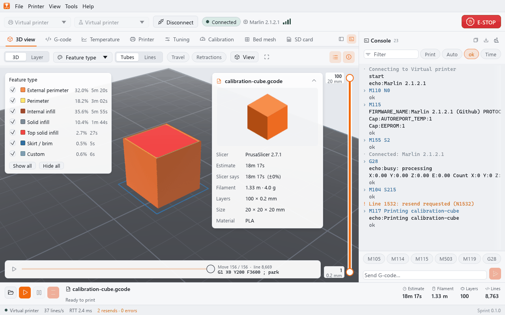
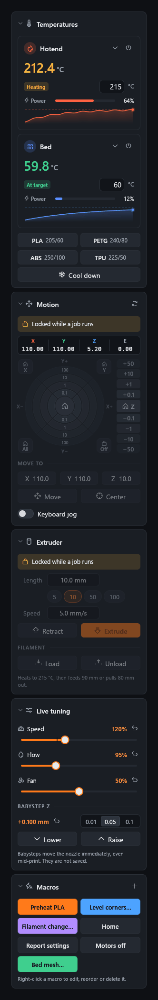
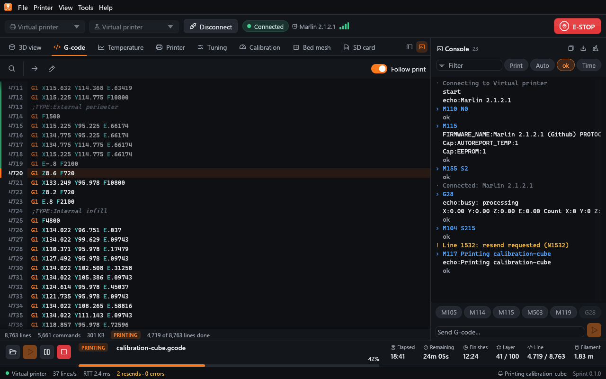
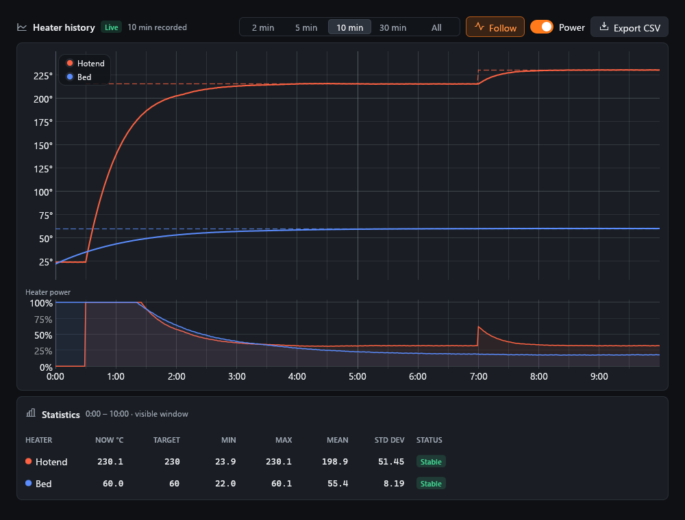
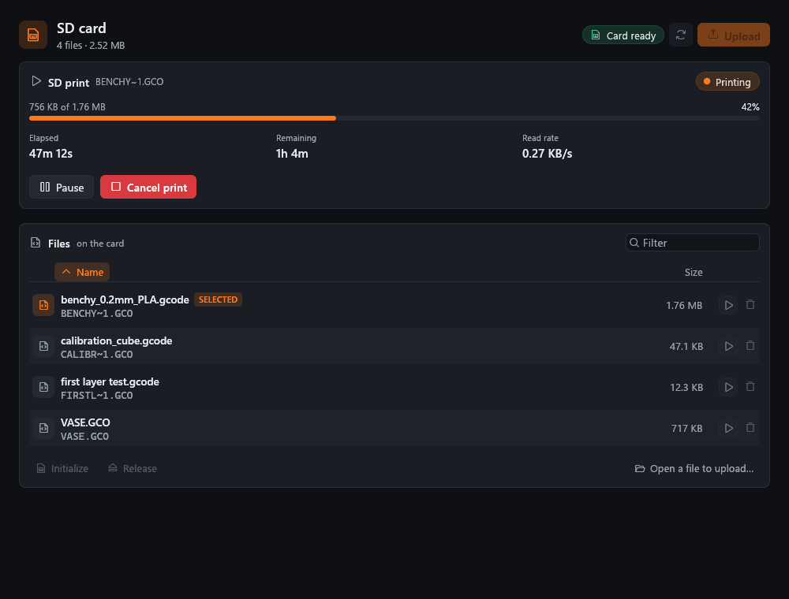
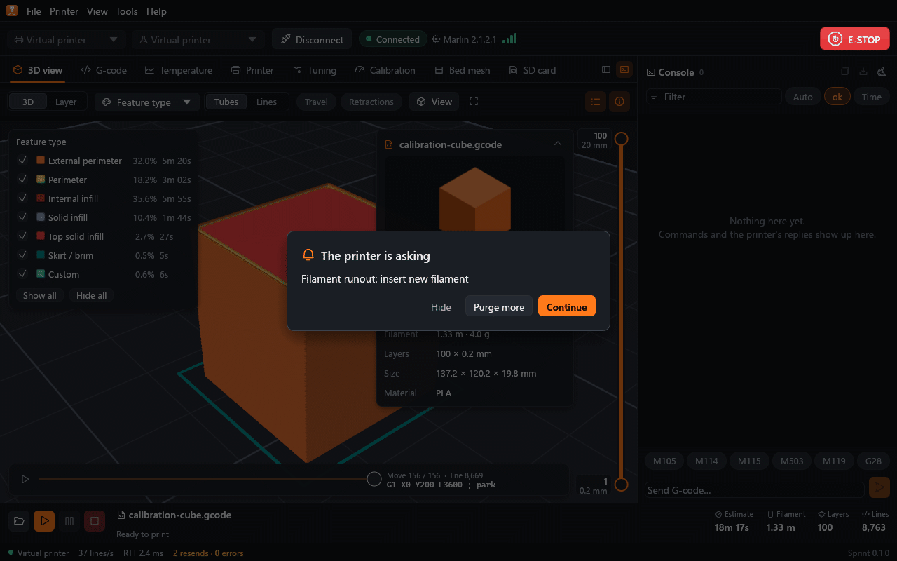
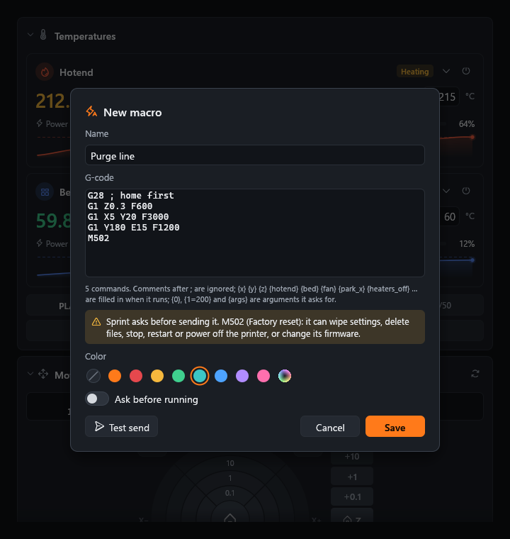
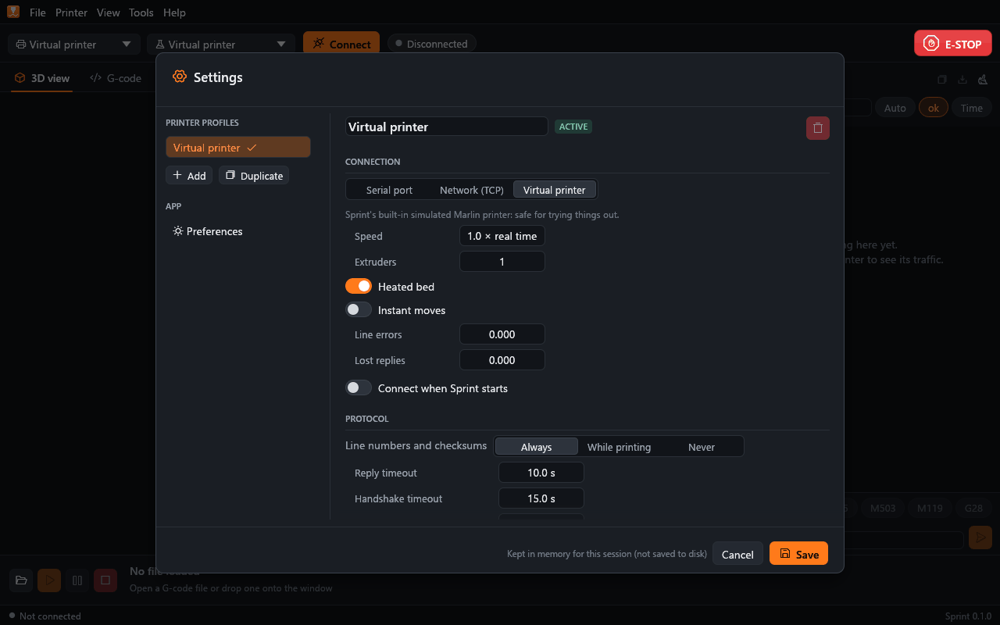

# The desktop GUI

```bash
sprint                       # open the GUI
sprint path/to/file.gcode    # ... with a file
sprint --sim                 # ... connected to the virtual printer
sprint gui --connect COM3    # ... connected to a printer (see the CLI page)
```

`sprint` and `sprint gui` are the same. The GUI connects at startup only
to the target you give it, to the virtual printer with `--sim`, or to the
active profile's printer when that profile has *Connect when Sprint
starts* turned on.


## Layout

| Area | What it holds |
|---|---|
| Menu bar | **File**, **Printer**, **View**, **Tools**, **Help** |
| Connection bar | Printer profile, port or address, baud rate, Connect, the connection status, the firmware name and link quality; the red **E-STOP** at the right |
| Controls sidebar (left) | Temperatures, motion, extruder, live tuning and macros |
| Tabs (centre) | 3D view, G-code, Temperature, Printer, Tuning, Calibration, Bed mesh, SD card |
| Console (right) | Everything sent to and received from the printer, and a G-code line |
| Job bar (bottom) | Open, print, pause/resume and cancel; the file, its status and progress, elapsed and remaining time, finish time, layer, line and filament |
| Status bar (bottom) | The link (target, lines per second, round-trip time, resends and errors), the last firmware message and Sprint's version |

The side panels can be resized by dragging their edges and hidden with the
two buttons at the right of the tab row or **View > Controls sidebar** /
**View > Console**. **View** also switches tabs, the 3D view's camera
presets and the dark and light themes. Window size, panel layout, the
console history and view options are remembered between runs.



## Opening files

* **File > Open G-code…** (Ctrl+O), the folder button in the job bar, or
  drag a file onto the window. **File > Open recent** lists the last files.
* The file is analysed in the background: the job bar shows the progress
  and can cancel it. Big files (millions of lines) load in seconds.
* Sprint notices when the file changes on disk; **File > Reload from disk**
  (F5) loads it again. **Tools > Analyze the file again** re-runs the
  analysis (after the printer's motion limits changed, for example) and
  keeps the view where it was.
* **File > Edit in external editor…** opens the file in the program named
  by the `SPRINT_EDITOR`, `VISUAL` or `EDITOR` environment variable (a
  program and its arguments; quote a path with spaces), else Notepad on
  Windows, `open -t` on macOS and `xdg-open` elsewhere. Sprint reloads the
  file when you save it there.
* Files that are not G-code (an STL or 3MF model, an OBJ or STEP file,
  binary G-code, other binary data) are recognised by their content and
  refused with an explanation, such as "This is a 3D model, not G-code:
  slice it first."

## Connecting

Pick the printer in the connection bar:

1. the **profile** (left dropdown) chooses the printer's settings;
2. the **port** dropdown offers the virtual printer, the serial ports found
   and a network address (`host:port`, for a serial-to-network bridge or
   `sprint sim`);
3. the **baud** dropdown offers the usual rates and **Auto**, which tries
   them in turn until the printer answers;
4. press **Connect**. While connecting, the button stops the attempt.

The status pill shows *Connecting*, *Handshaking*, *Connected* or *Halted*,
then the firmware name and a signal-strength indicator of the link
quality. After the handshake Sprint asks the printer for its firmware
information and capabilities (M115), its settings (M503) and position
(M114), and turns on temperature and position auto-reports when the
firmware supports them (otherwise it polls M105).

The **Printer** menu has **Connect** / **Disconnect**, **Reconnect**,
**Start print…**, **Pause** / **Resume**, **Cancel print…**, **Home all
axes (G28)**, **Motors off (M84)**, **Read firmware info and settings**,
the halt recovery commands (below) and **Emergency stop (M112)**.

Disconnecting, reconnecting or quitting while a job runs asks first and
says what will happen: a host print is cancelled first (its cancel script
runs), an SD upload is cancelled and the partly written file deleted, and
the connection closes once the printer has stopped. An SD print keeps
running on the printer.

### Emergency stop and halts

**E-STOP** sends M112 at once, ahead of everything queued; it is never
asked about and stays clickable above dialogs. The firmware halts: Sprint
shows a red banner with the reason, and the controls stay disabled until
the printer runs again. The banner and the **Printer** menu offer:

* **Reset board**: restarts the printer's board. On a serial port Sprint
  closes the port and opens it again with a DTR pulse, which resets most
  boards, then handshakes again; the virtual printer resets itself. A
  board behind a network bridge cannot be reset this way: press its reset
  button or power-cycle it, then **Reconnect**.
* **Restart firmware (M999)**: for halts the firmware can recover from in
  place (Marlin's "Printer stopped ... use M999", Klipper's
  `FIRMWARE_RESTART`). After M112 or a thermal runaway Marlin ignores
  M999 until its board is reset.
* **Reconnect**: closes and opens the connection.

A print that was running when the printer halted has failed; see
[Recovering a failed print](#recovering-a-failed-print).

## Controls sidebar



Each section folds away with its header. Everything that moves the
machine or extrudes is disabled while a print runs (the host would mix
those commands into the print stream) and available again while a host
print is paused; temperatures, fans, overrides and babystepping work
during a print.

**Temperatures.** One card per heater (hotends, bed, chamber when the
profile has one) with the reading, the target (type it and press Enter),
heating state, power and a short history. The arrow opens presets for that
heater; the power button turns it off. Below, the profile's material
presets set hotend and bed together, and **Cool down** turns every heater
off. Turning a heater off or changing presets during a print asks first.

**Motion.** The current position, an X/Y jog wheel with rings for 0.1, 1,
10 and 100 mm, a Z strip from 0.1 to 50 mm, homing buttons for X, Y, Z and
all axes, motors off, an absolute **Move to** X/Y/Z, and **Center** (the
middle of the bed). **Keyboard jog**, once turned on and after a click into
the sidebar, moves X/Y with the arrow keys and Z with PgUp/PgDn; Shift
makes the step ten times larger, except for Z down (PgDn). Sprint warns
before a move when the axes are not known to be homed.

**Extruder.** The tool (with several extruders), a length (5, 10, 50,
100 mm or typed) and speed, **Extrude** and **Retract**. A cold hotend
(below 170 °C) offers to heat to a preset first. **Load** and **Unload**
use the firmware's M701/M702 and fall back to a scripted sequence (heat,
feed 60 mm and purge 30 mm; or push 5 mm and pull 80 mm out) when the
firmware does not know them.

**Live tuning.** Speed (M220) and flow (M221, per tool) overrides, the
part fan (M106/M107) and Z babystepping (M290) in steps of 0.01, 0.05 or
0.1 mm. Sliders send their value when released; the arrow next to each
resets it. Babysteps move the nozzle immediately, even mid-print, and are
not saved.

**Macros.** Your G-code buttons (see [Macros](#macros)).

## The 3D view tab

The viewer draws every extrusion as a lit bead (or as thin lines, for huge
files and slow GPUs) on the bed of the active profile.


**Toolbar.** **3D** / **Layer** switches between the orbiting 3D view and
an orthographic view from above of the top visible layer, with the layers
below ghosted. The color menu colors by feature type, speed, width, layer
height, tool, fan, layer or time. **Tubes** / **Lines** picks the style;
**Travel** and **Retractions** show travel moves and retraction points.
**View** has the camera presets, **Fit to view**, the style, and whether to
draw the bed, the build volume, the axes and the tool head. The buttons at
the right fit the view, show the legend and show the file card; while a
file prints, **Follow print** keeps the top layer at the layer being
printed.

**Mouse.**

| Action | Does |
|---|---|
| Drag with the left button | Orbit |
| Drag with the right or middle button, or Shift + left | Pan |
| Wheel | Zoom towards the cursor |
| Double-click | Focus the camera on the point clicked |
| Click | Select the move (bead, or travel move while travels are shown) under the cursor; the G-code tab shows its line |
| Hover | Highlight the move and show its line |

**Keys** (with the pointer over the view): 1 to 7 for the iso, top,
bottom, front, back, left and right presets, Z to fit, ↑/↓ to move the top
layer, PgUp/PgDn by ten layers, Home/End for the first and last layer, and
Shift with these keys for the lower layer handle.

**Layer slider.** The double slider on the right sets the lowest and
highest layer shown (drag either handle). Below the view, the scrub bar
steps through the moves of the top layer (or plays them) and shows the
current line.

**Legend.** Lists the features with their share of the print time; click
a feature to hide or show it. For the gradient color modes it shows the
scale.

**File card.** The slicer's thumbnail, the slicer, Sprint's estimate and
the slicer's, filament length and weight, layers, the part size and the
material.

**Objects.** When the file labels objects (Marlin `M486`, Klipper
`EXCLUDE_OBJECT_*`, PrusaSlicer `; printing object`, Cura `;MESH:`), the
Objects card lists them with their print time and filament; pointing at
one shows where it is. During a host print each object can be skipped
(after a confirmation the rest of that object is left out: Sprint stops
sending its moves and extrusion and travels on to the next part);
excluded objects and the object being printed are marked, and the job bar's
tooltip lists the excluded ones. Skipped objects can be included again.
Sprint does the exclusion itself, so it works on any firmware.

While a file prints, the printed part is drawn solid and the rest ghosted,
with the tool head at the current position.

## The G-code tab



The whole file with line numbers and syntax colors; hovering a command
shows its description from Sprint's G-code reference. The printed lines
are marked, and **Follow print** keeps the line being printed in view.
Selecting a line selects the move in the 3D view and the other way round.

* **Find** (Ctrl+F; Enter and Shift+Enter for the next and previous match,
  with a match-case option) and **Go to line** (Ctrl+G).
* The pencil button opens the file in your external editor.
* The right-click menu copies a line, shows it in the 3D view, starts a
  print from that line (**Start print from here…**) or sends the line to
  the printer.

## The Temperature tab



The history of every heater (about one sample a second, the last 30
minutes): readings as solid lines, targets dashed, heater power below.
Pick a window of 2, 5, 10 or 30 minutes or all of it; dragging or zooming
stops following the newest readings until you press **Follow**. The table
below gives each heater's current value, target, minimum, maximum, mean,
standard deviation and whether it holds its target. **Export CSV** saves
the whole history.

## The Printer tab


Cards that refresh themselves while connected (the round arrows ask
again):

* **Firmware**: name, version, flavor, machine, extruders, protocol, UUID
  and source (M115).
* **Thermal health**: per heater the mean, standard deviation and
  peak-to-peak at the target, time to target, overshoot, settling time and
  holding power, with findings such as an oscillating heater (and a button
  to calibrate its PID).
* **Link**: round-trip times, throughput, the queue, lines sent and
  acknowledged, resends, bytes and errors.
* **Statistics** (M78): prints, finished and failed, total and longest
  print time, filament used.
* **Capabilities** (M115 `Cap:` lines) grouped by purpose, with
  descriptions.
* **Position** (M114) with stepper counts, **Endstops** (M119, optionally
  live), a **Settings** summary (M503; the pencil opens the Tuning tab) and
  the recent **Firmware messages**.

## The Tuning tab


Every setting the firmware reported with M503, as cards with named fields,
units and descriptions (steps per mm, feedrates, accelerations, jerk and
junction deviation, PID gains, probe and home offsets, linear advance,
driver currents, retraction, ...), one row per extruder or driver where
the firmware has several. Settings Sprint does not know are edited as raw
G-code.

* Search, or pick a category or **Modified** on the left.
* Edits are only sent when you press **Apply N changes**; **Show changes**
  lists them and **Revert** drops them. Edits that would disturb a running
  print ask first.
* **Save to EEPROM** (M500) keeps the applied values after a restart,
  **Load from EEPROM** (M501) goes back to the stored ones, **Factory
  reset** (M502, asks first) restores the firmware defaults.
* The toolbar reloads the settings (M503), copies them all as G-code,
  exports them to a file and imports a file (with a preview of what would
  change).

Prusa firmware reports separate *normal* and *stealth* (silent mode)
limits; both are shown and edited separately.

Marlin reports **Autotemp** as `M104 S<min> B<max> F<factor>`. Sending that
back would also set the hotend temperature, so the card is read-only and an
import skips any line that would heat or move the printer. Type the command
in the console if you mean to send it.

## The Calibration tab


Four guided procedures:

* **PID autotune** (M303): pick the hotend or bed, a target (or a material
  preset) and the number of cycles, start it and watch the oscillation.
  The result is compared with the current gains; **Apply gains** sends them
  and **Save to EEPROM** keeps them. Run it with the part fan at your usual
  speed.
* **Extruder E-steps** (M92 E): heat, mark the filament 120 mm above the
  extruder, extrude 100 mm slowly, measure what is left; Sprint computes the
  new steps per mm, applies and saves them.
* **Z offset**: babystep the nozzle while it prints a first-layer test (or
  over a sheet of paper), then store the adjustment in the probe offset
  (M851 Z) or the home offset (M206 Z) and save it.
* **Flow**: print a single-wall cube, measure its walls and get the
  corrected flow (for the slicer, or M221 on the printer until the next
  restart).

## The Bed mesh tab


**Probe bed** runs G29 (after homing); **Load** reads the mesh the printer
has stored (M420 V). The mesh is shown as a heatmap seen from above, front
row at the bottom, with its lowest and highest point, range, mean and
standard deviation, and as a 3D surface (drag to turn it). The **Leveling**
card turns mesh compensation on and off (M420 S), sets the fade height and
saves both.

The **bed screws** helper tells you how far to turn each leveling screw:
pick the thread (M3, M4, M5) and which way lowers the bed, place the
screws (or **Four corners**), and click a screw to make it the reference.
The plan and the list show the turn per screw ("1/4 turn clockwise");
adjust, probe again and repeat.

## The SD card tab



The card's files (M20) with long names, sizes and a filter. Each row can
start an SD print (the printer reads the file itself; Sprint follows the
progress with M27) or delete the file (asks first). **Upload** writes the
loaded G-code file to the card under a valid 8.3 name; the progress shows
in the card's job panel and the job bar. **Initialize** (M21) mounts a card
you just inserted; **Release** (M22) lets you remove it safely. SD prints
can be paused, resumed and cancelled like host prints.

## The console

Everything Sprint sends (`>`) and the printer answers, colored by kind
(sent commands, replies, information, warnings, errors).

* The filter box searches; **Auto** shows automatic traffic (temperature
  and position reports and polling), **ok** shows bare `ok` replies,
  **Time** adds timestamps. The lines a print streams are hidden by
  default; the console's stream filter can show every line of the file as
  it goes out.
* The buttons at the top copy the shown lines, export them to a file and
  clear the console.
* The command line sends G-code: Enter sends, Shift+Enter starts a new
  line (a pasted block is sent line by line), ↑/↓ walk the history, and
  typing shows suggestions from the G-code reference (Tab accepts). The
  quick buttons send common queries (M105, M114, M115, M503, M119) and
  G28.
* Commands go through the same safety rules as everywhere (see the
  [user guide](user-guide.md#safety)): a dangerous command, or one that
  would disturb the running print, asks before it is sent. M112 is sent at
  once.

## Printing

### Starting a print

**Start print…** (Ctrl+P, or the play button) opens the start dialog:


* **Start from** the beginning, a **layer** or a **line**. Starting later
  adds a *resume preamble*: G-code that heats to the temperatures in effect
  there, sets units and modes, homes X and Y (optionally Z), lifts by the Z
  clearance, travels to where that line starts, lowers and restores the
  extruder position and feedrate. The options (**Home X/Y**, **Home Z**,
  **Wait for temperatures**, **Board was reset**, **Z clearance**) rebuild
  it, and you can edit it before starting (**Regenerate** undoes edits).
  Turn on **Board was reset** after a power loss or a reset that left the
  nozzle where it stopped: the preamble then declares the nozzle's height
  (G92 Z) instead of trusting the firmware's, which is 0 after a reset.
  Layers whose first command started in a layer below (a long spiral) are
  not offered; the dialog suggests the next layer that starts cleanly.
* The dialog can also pause the print (with the pause script) before a
  chosen layer, for a filament swap or inserts.
* **Show progress on the printer's display (M73)** sends the percentage
  and remaining minutes to the printer's screen during this print. A
  profile with this setting turned on sends it for every print (see
  [Configuration](configuration.md#progress-on-the-printers-display)).

Sprint refuses to start while the printer prints from its own card, while
it is halted or without a connection, and says why.

### While it prints

The job bar shows the status, progress (by estimated time, so it moves
evenly), elapsed and remaining time (corrected by how fast the print
actually goes), the finish time, layer, line and filament. The 3D view and
the G-code tab follow the print.

When the printer asks something (a filament change, an M0 "insert
magnets", a runout), a dialog shows its question and buttons; **Hide**
keeps it for later.



When the firmware waits for the user without a question (M0/M1 on
firmware without host prompts), the job bar shows **Continue** (M108).

When a print completes or fails, Sprint shows a notification and asks the
window manager for your attention (the taskbar button flashes).

### Pausing, resuming and cancelling

* **Pause** (Space, or the pause button) waits for the commands already
  sent and runs the profile's **pause script**: by default it retracts
  2 mm, lifts 10 mm and parks at the back left corner. While paused you can
  jog, move, extrude, change temperatures and type G-code; homing Z and
  probing still ask.
* **Resume** runs the **resume script** (back to the paused position,
  lower, prime, restore the extruder position and feedrate) after
  re-establishing units, positioning and extrusion modes and the
  temperatures the print had, then continues streaming.
* **Cancel** asks first; the profile's **cancel script** then runs (by
  default every heater and the fan off, lift 10 mm, home X and Y, motors
  off). Check a custom script in the printer profile: the question only
  says that it runs.

A pause made at the printer (its menu, `//action:pause`, M600) shows as
paused in Sprint too; **Resume** continues it.

### Recovering a failed print

When a host print fails or is cancelled (a halt, a lost connection, a
power loss), Sprint remembers the first line the printer had not
confirmed. With that file loaded, the job bar offers **Recover…**, which
opens the start dialog at that line with the resume preamble, ready to
check and start. After a power loss or board reset, turn on **Board was
reset**.

### Hook commands and notifications

A profile can run a program when a print starts, finishes, fails or is
cancelled, for example to send yourself a message or switch a relay. See
[Configuration](configuration.md#hook-commands).

## Macros



Macros are G-code buttons in the sidebar. **+** adds one; right-click a
macro to edit, duplicate, reorder or delete it. A macro has a name, its
G-code, an optional color and **Ask before running**. The editor warns
about dangerous commands and can **Test send** the G-code.

Macro G-code can use the script placeholders (`{x}`, `{hotend}`,
`{park_x}`, `{heaters_off}`, ...; see
[Configuration](configuration.md#placeholders)), filled in when the macro
runs; confirmations show the G-code with the placeholders filled in. A
macro defined in the shell may take arguments (`{0}`, `{1}`, `{args}`):
the GUI asks for them before running it. Macros follow the same safety
rules as typed commands (see the [user guide](user-guide.md#safety)): a
macro asks first when it is set to **Ask before running** or holds a
command that is dangerous or would disturb the running print.

The default macros are **Home**, **Bed mesh** (G28, G29, M420 V; asks
first), **Cool down** and **Motors off**.

## Settings and printer profiles



**Tools > Settings…** (Ctrl+,) opens the preferences; **Tools > Printer
profiles…** the profiles. Changes apply when you press **Save**.

**Preferences**: the theme, how many console lines are kept, and the path
of the configuration file in use (`SPRINT_CONFIG` or the default
location).

**Profiles**: **Add**, **Duplicate**, delete, rename and **Use this
printer** (switch while disconnected). Each profile has:

* **Connection**: serial port and baud, network address, or the virtual
  printer with its options; *Connect when Sprint starts*.
* **Protocol**: line numbers and checksums (always, while printing, never),
  reply and handshake timeouts, temperature polling and auto-report
  intervals, commands in flight, reading firmware info after connecting,
  resetting the board when connecting.
* **Machine**: bed width and depth, maximum height, origin (front left or
  bed centre), extruders, heated bed and chamber; filament and nozzle
  diameter.
* **Temperature presets**, **jog speeds**, and the **pause, resume and
  cancel scripts**.
* Whether prints show their progress on the printer's display (M73), and
  the **hook commands** with the environment variables they receive.
* **Print time estimation**: custom motion limits, or the firmware's.

When the configuration file had damaged lines, Sprint says so at startup,
keeps everything valid, and the settings show what was dropped and where
the original was backed up. See [Configuration](configuration.md).

## Keyboard shortcuts

**Help > Keyboard shortcuts** lists them in the app.

| Keys | Action |
|---|---|
| Ctrl+O | Open a G-code file |
| F5 | Reload the file from disk |
| Ctrl+P | Start print… |
| Space | Pause / resume the print |
| Ctrl+F | Find in the G-code |
| Ctrl+G | Go to line |
| Ctrl+, | Settings |
| 1 – 7 | View presets: iso, top, bottom, front, back, left, right |
| Z | Fit the 3D view to the toolpath |
| ↑ / ↓ | Top layer up / down (3D view) |
| PgUp / PgDn | Top layer ±10 |
| Home / End | First / last layer |
| Shift + layer keys | Move the lower layer handle |
| Arrows, PgUp / PgDn | Keyboard jog X/Y and Z, once turned on (after a click in the controls) |
| Shift + jog keys | Jog ten times as far (not Z down) |
| Enter / Shift+Enter | Console: send / new line; Find: next / previous |
| ↑ / ↓ in the console | Command history (or suggestions) |
| Tab | Accept a G-code suggestion |
| Esc | Close dialogs, find and go to line |

On macOS, Cmd replaces Ctrl.
